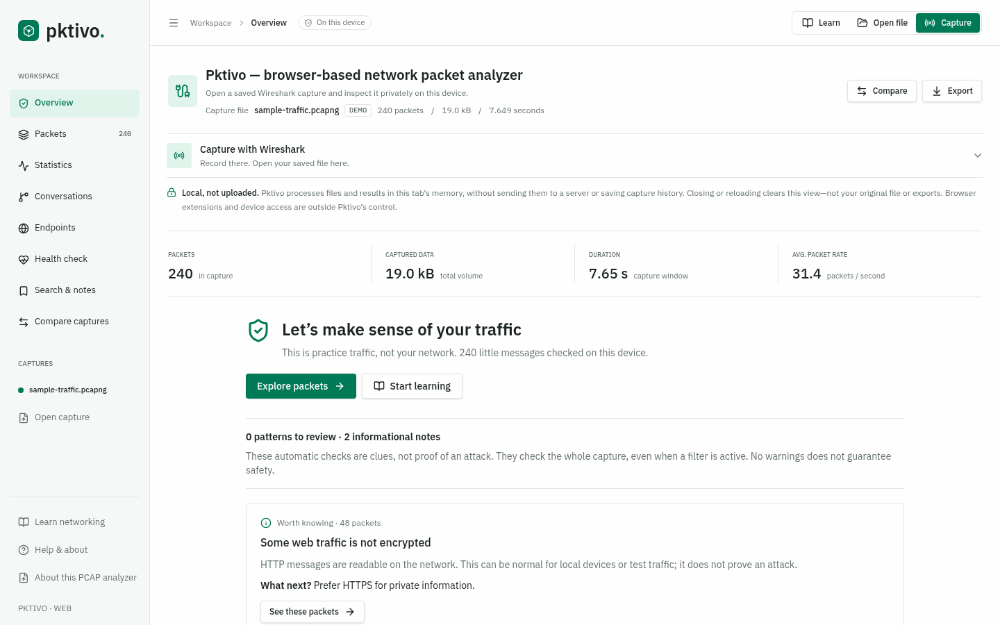
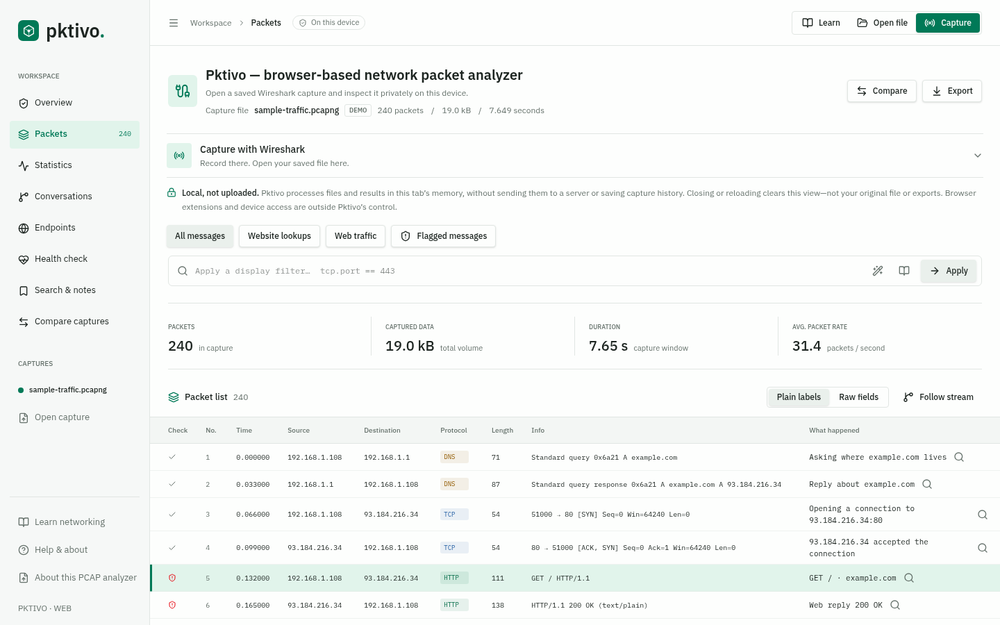
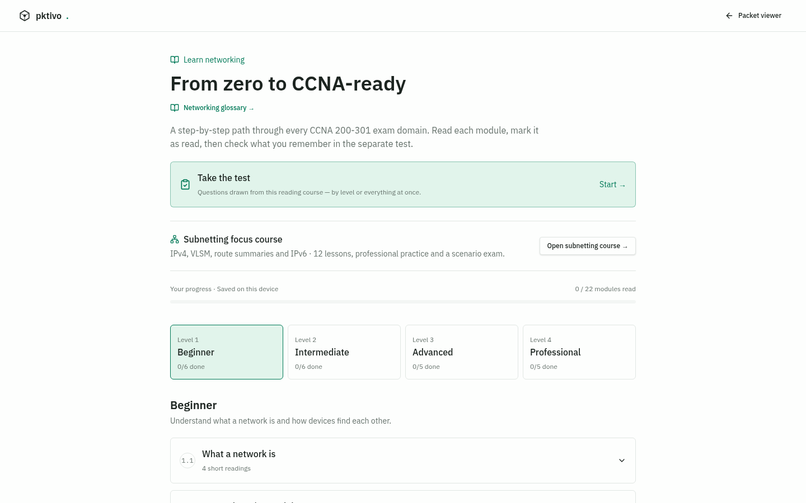

# Pktivo

**A network packet analyzer that runs entirely in your browser.**

Pktivo (pronounced *packet-ee-vo*) opens the capture files Wireshark records and lets you read them
without installing anything, without an account, and without your traffic ever leaving the device.

**Live app:** <https://pktivo.com>



---

## Private by design

- **Nothing is uploaded.** Capture files are read in the browser tab's memory. There is no upload
  step, no server-side copy and no capture history.
- **Gone when the tab closes.** Closing or reloading the tab clears the capture and every result
  derived from it.
- **No analysis calls home.** Packet decoding, warnings, health checks, subnet calculations and
  search all run locally in JavaScript.
- **No ads, no sign-in, no third-party pixels.** Visit and click measurement is cookieless, off by
  default, and controlled from an on-page **Cookie settings** control.

## What it does

### Read a capture

| | |
| --- | --- |
| **Formats** | `pcap` and `pcapng` — the files Wireshark, `tcpdump` and `dumpcap` write |
| **Protocols** | Ethernet, 802.1Q, IPv4, IPv6, ARP, ICMP, ICMPv6, IGMP, TCP, UDP, DNS, LLMNR, SSDP, HTTP, TLS, QUIC, SSH, DHCP, NTP, OSPF, GRE, ESP, EAPOL, LLDP, loopback |
| **Packet list** | Plain-language descriptions next to raw fields, sortable columns, pagination |
| **Packet details** | Protocol tree with clickable byte selection in the hex and ASCII views |
| **What happened** | Per-packet story: direction, the addresses involved, and the website name when the capture reveals it (DNS, TLS SNI, HTTP Host) |
| **Filters** | Wireshark-style display filters, a click-to-build filter panel, and saved filters for the visit |
| **Streams** | Follow TCP streams, conversations and endpoint tables |
| **Statistics** | Capture totals, packet rate, protocol breakdown, health and latency check |
| **Compare** | Load two captures side by side and see what changed between them |
| **Notes & search** | Search decoded fields, bookmark packets, add notes, export to CSV or JSON |



### Learn networking

Pktivo doubles as a study tool. The course is aimed at Cisco CCNA 200-301 and starts from zero.

- **From zero to CCNA-ready** — 22 modules across Beginner, Intermediate, Advanced and Professional,
  each with short readings and a check-yourself question.
- **Subnetting focus course** — 12 lessons on IPv4, VLSM, route summaries and IPv6, plus professional
  practice and a 20-question scenario exam with answer reviews.
- **Practice test** — randomized questions drawn from the readings, with explanations for every answer.
- **Lessons to revisit** — after a test, the results page points back at the modules your missed
  questions came from.
- **Networking glossary** — Wireshark and networking terms, cross-linked to the courses.
- **Beginner capture guide** — how to read a capture, start to finish.



Reading progress is saved on the device, so checkmarks survive closing the tab. Practice and exam
attempts stay in visit memory only.

### Make it yours

Twelve appearances — light, dark, and ten color themes including purple/black and yellow/black —
chosen from the menu and remembered on the device.

## Quick start

1. Record traffic in **Wireshark** (or `tcpdump -w capture.pcapng`) and stop when you have enough.
2. Open <https://pktivo.com> and click **Open file**, or drag the saved file onto the page.
3. Read the **Overview** for the summary, then **Packets** for the detail. Click a packet to see
   **What happened**.

Pktivo does not capture traffic itself — Wireshark records it, Pktivo reads the file. That split is
what keeps the analyzer free of driver installs, admin rights and background services.

## Development

```bash
npm install
npm run dev      # local preview
npm run test     # unit tests
npm run build    # production build
```

TanStack Start (React 19, Vite, Tailwind CSS v4). Capture parsing, dissection, filtering, statistics
and the learning modules are plain TypeScript in `src/lib/netlens` and `src/lib/learn`, each covered
by tests in `src/test`.

## A note on results

Pktivo is built with AI and is still being improved. Treat its explanations, warnings and health
checks as strong hints rather than guarantees — no warnings does not mean a network is safe, and a
flagged packet is not proof of an attack. Verify anything important against the raw packet details.

## License

Pktivo is licensed under the [Apache License, Version 2.0](LICENSE). You may use, modify and
redistribute it, including in commercial products, as long as you keep the license notice and state
any changes you made. The license also grants a patent licence from the people who contribute code.

Contributions are welcome and are offered under the same Apache-2.0 licence, so improvements stay
usable by everyone. The note above about AI-built results applies to contributed code as well.

Copyright 2026 Pktivo
